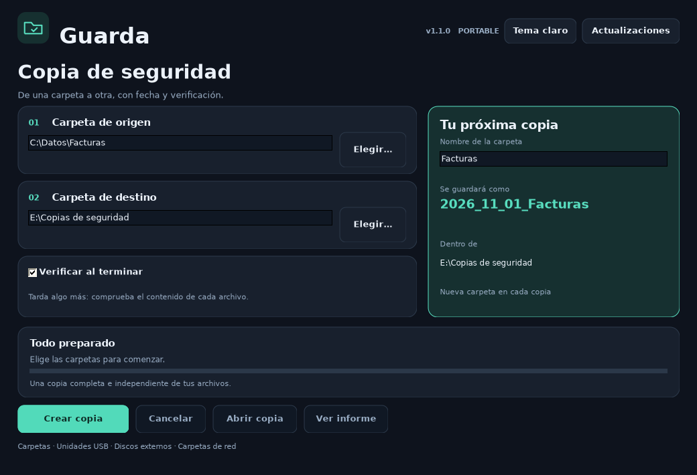

# Guarda

Copias de carpetas para Windows, con fecha en el nombre. Elige una carpeta de origen y otra de destino: un pendrive, un disco externo, otra carpeta del equipo o una carpeta de red accesible.

1. **[Descripción del programa](DESCRIPCION.md)**
2. **[Cómo funciona y guía](docs/README.md)**
3. **[Descargar](descargas/README.md)**
4. **[Notas de parche](notas-de-parche/README.md)**

Por ejemplo, al copiar la carpeta `Facturas`, Guarda crea `2026_11_01_Facturas`. Las copias adicionales del mismo día reciben un sufijo como `_02`.

La verificación de contenido está activada por defecto. También incluye progreso, cancelación e informes. La versión disponible es **1.1.0**.

## Nuevo diseño y actualizaciones

- **Modo oscuro y tema claro**, con la elección guardada.
- Vista previa del nombre de la copia, selección de carpetas por pasos y progreso en una ventana renovada.
- **Actualizaciones desde la app**: buscar versiones, leer novedades, descargar y reiniciar conservando las preferencias.
- Anuncios firmados y descarga comprobada antes de sustituir el ejecutable.

[Ver el tema claro](docs/diseno-claro.png) · [Ver la ventana de actualizaciones](docs/actualizaciones.png).

**Si tienes 1.0.1 o Copia Fácil:** descarga esta nueva versión una vez desde [Descargar](descargas/README.md). El botón de actualizaciones está disponible a partir de 1.1.0.

Se ha comprobado el motor con archivos reales bajo Linux/Mono y una copia desde la ventana. **Pendiente de validación en Windows real y con un pendrive físico.** Consulta el [informe de comprobaciones](docs/VALIDACION.txt).

Documentación complementaria: [Código](Codigo/) · [Contexto del proyecto](CONTEXTO.md) · [Instrucciones de desarrollo](AGENTS.md) · [Metadatos](app.json).

[Volver al catálogo de aplicaciones](https://github.com/xycel95/Apps/blob/main/README.md).
