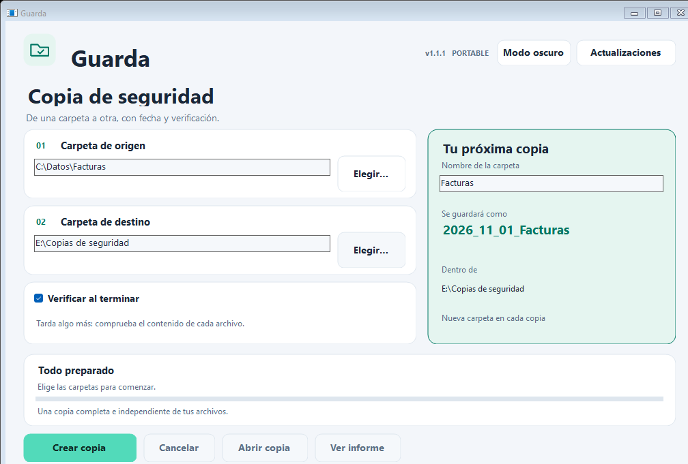
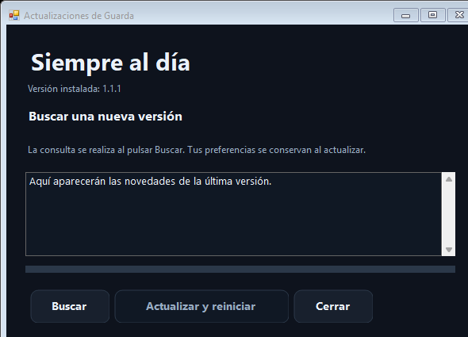

# Cómo funciona y guía

## Crear tu primera copia

1. Descarga y abre **Guarda.exe** desde [Descargar](../descargas/README.md).
2. En **Origen**, pulsa **Elegir…** y selecciona la carpeta que quieres copiar. También puedes pegar su ruta o arrastrar una carpeta al campo.
3. En **Destino**, selecciona dónde guardar la nueva copia: por ejemplo, una carpeta dentro de tu pendrive.
4. Revisa el nombre de la copia. La fecha se añade automáticamente al principio.
5. Mantén activada la comprobación del contenido si quieres que se relean los archivos guardados y se comparen con el original.
6. Pulsa **Crear copia** y espera a **Copia terminada**. Después puedes pulsar **Abrir copia** o **Ver informe**.

## Ejemplo

| Opción | Valor |
| --- | --- |
| Origen | `C:\Datos\Facturas` |
| Destino | `E:\Copias` |
| Nombre | `Facturas` |
| Carpeta resultante | `E:\Copias\2026_11_01_Facturas` |
| Segunda copia ese día | `E:\Copias\2026_11_01_Facturas_02` |

La fecha utilizada es la fecha local del ordenador al empezar la copia. La carpeta de origen conserva su nombre.

## Comprobación del contenido

La casilla **Verificar al terminar** está activada por defecto. Guarda calcula la huella SHA-256 del contenido leído del original y vuelve a leer cada archivo del destino para comparar ambas huellas. Este segundo paso requiere tiempo adicional.

También vuelve a revisar el origen para detectar archivos que se hayan añadido, quitado o modificado mientras trabajaba. Cierra las aplicaciones que estén modificando los archivos que quieres copiar.

## Cancelaciones y copias incompletas

Durante el proceso, la carpeta lleva un sufijo `_EN_CURSO_` y un identificador. Al terminar correctamente, ese sufijo desaparece. Si cancelas o hay un error, se intenta marcar como `_INCOMPLETA` y se conservan los archivos ya terminados. El archivo que estaba escribiéndose se elimina de esa nueva copia si es posible.

Si se desconecta la unidad, la carpeta puede conservar el nombre `_EN_CURSO_`. Tanto ese nombre como `_INCOMPLETA` indican que la copia no está terminada. No se reanuda una copia incompleta: el siguiente intento crea una nueva.

Los enlaces y otros puntos de reanálisis no se copian y se identifican en el informe. El destino debe existir, estar conectado y estar fuera del origen.

## Preferencias e informes

Se guardan normalmente en `%LOCALAPPDATA%\Guarda`. Guarda recupera las preferencias de la versión anterior llamada Copia Fácil cuando aún no existen preferencias propias.

Si el informe quedaría dentro del origen, se guarda en `_Informes_Guarda` dentro del destino, para evitar copiar un registro que la aplicación está escribiendo.

## Modo oscuro y tema claro

Utiliza **Tema claro** para pasar al tema claro y **Modo oscuro** para volver al oscuro. La app recuerda la elección. La copia y sus opciones son las mismas en ambos temas.

## Actualizar desde la propia app

1. Cuando no haya una copia en curso, pulsa **Actualizaciones**.
2. Pulsa **Buscar** para consultar el canal oficial.
3. Si hay una nueva versión, revisa sus novedades y pulsa **Actualizar y reiniciar**.
4. Espera a que finalice la descarga y su comprobación. Guarda prepara la instalación antes de cerrar la ventana; después sustituye el programa y lo abre de nuevo.

Las preferencias se conservan. El anuncio debe estar firmado con la clave oficial de Guarda y el archivo debe coincidir en versión, identidad, tamaño y SHA-256. Se conserva una copia anterior del ejecutable junto al programa. Si falla su apertura, se intenta restaurar la anterior.

La búsqueda y descarga necesitan Internet. Si no hay conexión o no se puede escribir en la carpeta del programa, se muestra un mensaje; puedes seguir utilizando la app o descargar el ejecutable desde [Descargar](../descargas/README.md). No hay instalación silenciosa al iniciar.

**Importante para 1.0.1 y Copia Fácil:** esas versiones aún no tenían el actualizador. Descarga la versión actual manualmente una vez; después tendrás el botón integrado.

[Guía completa en texto](LEEME.txt) · [Comprobaciones y limitaciones](VALIDACION.txt) · [Descargar](../descargas/README.md).
