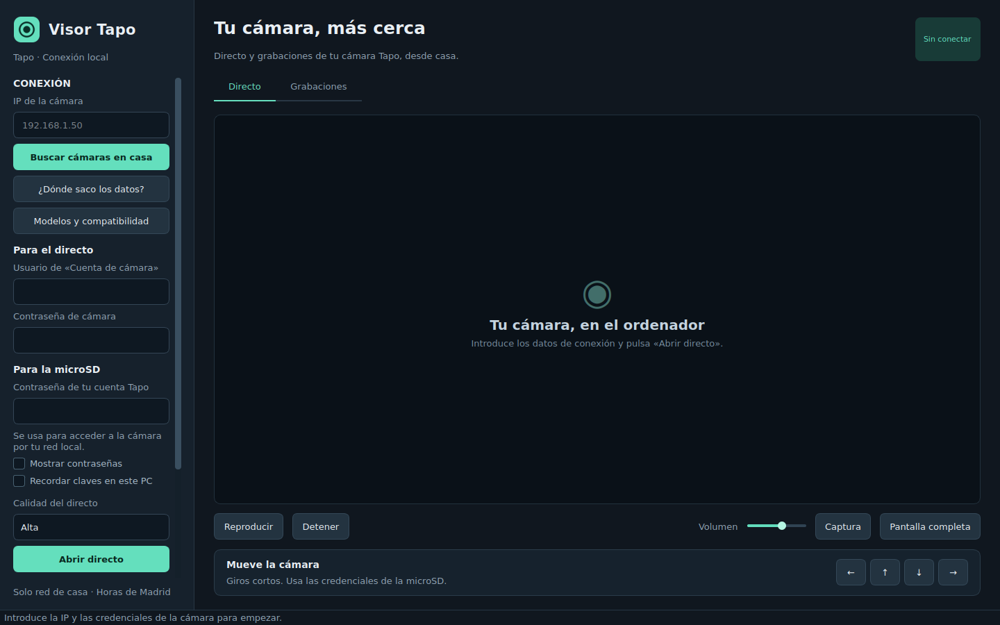
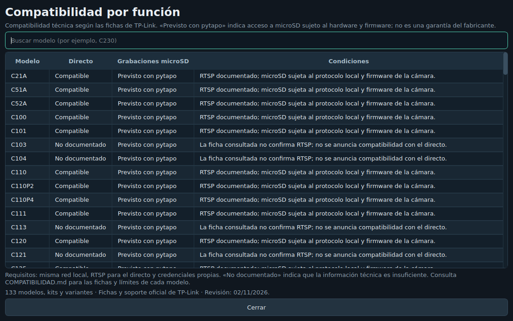

# Visor Tapo

Aplicación independiente para Windows que permite ver el directo de una cámara
Tapo y acceder a sus grabaciones microSD desde la red de casa.

1. **[Descripción del programa](DESCRIPCION.md)**
2. **[Cómo funciona y guía](docs/README.md)**
3. **[Descargar](descargas/README.md)**
4. **[Notas de parche](notas-de-parche/README.md)**

Incluye búsqueda de cámaras en la red local, ayuda para configurar las
credenciales, reproducción, capturas y copias de vídeos en el PC.
**Versión 1.2.0: un único `.exe` portable.** Puedes moverlo o renombrarlo y abrirlo directamente; lleva el programa y sus dependencias dentro. La preparación temporal es automática.

Antes se llamaba **Visor C230** y conserva los ajustes y copias del mismo usuario de Windows.

## Cámaras compatibles

Consulta la **[lista de 133 modelos, kits y variantes](docs/COMPATIBILIDAD.md)**,
basada en fichas y soporte oficial. Distingue directo compatible, con condiciones,
no compatible y soporte no documentado. Incluye variantes regionales y modelos
anteriores de los catálogos global, español y estadounidense revisados.

La app permite buscar el modelo en **«Modelos y compatibilidad»**. El directo
requiere RTSP; el acceso a microSD mediante pytapo depende del hardware, firmware
y autenticación. **«Previsto con pytapo» es una previsión técnica por integración,
no una certificación por modelo.** Las grabaciones detrás de un hub quedan fuera
de esta versión. No se ofrece acceso a Tapo Care.

Documentación complementaria: [Código](Codigo/) · [Licencia](LICENSE) ·
[Componentes de terceros](docs/TERCEROS.md) · [Validación](docs/VALIDACION.txt) ·
[Contexto](CONTEXTO.md) · [Instrucciones de desarrollo](AGENTS.md) · [Metadatos](app.json).

Proyecto no oficial, independiente de TP-Link/Tapo.

[Volver al catálogo de aplicaciones](https://github.com/xycel95/Apps/blob/main/README.md).
